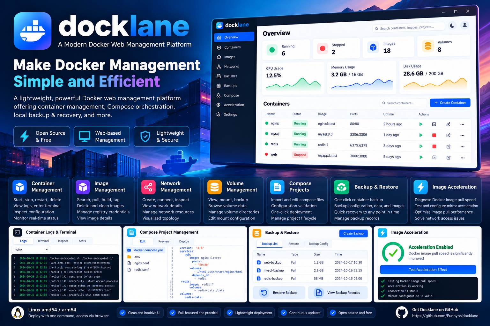
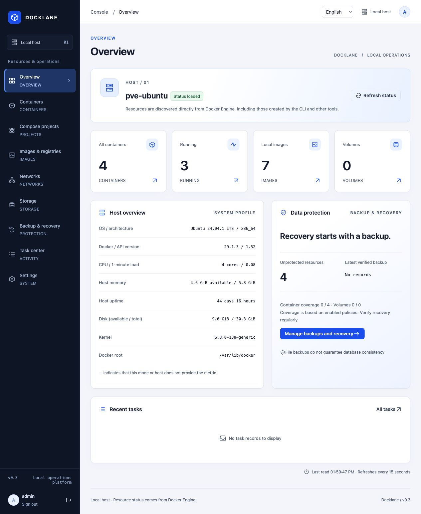
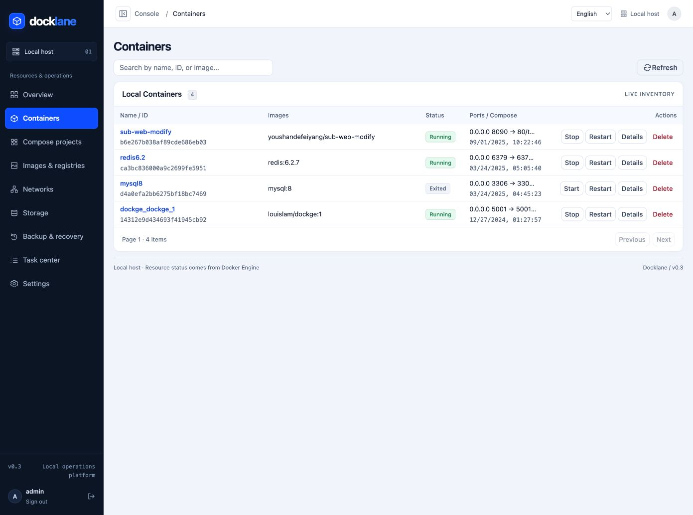
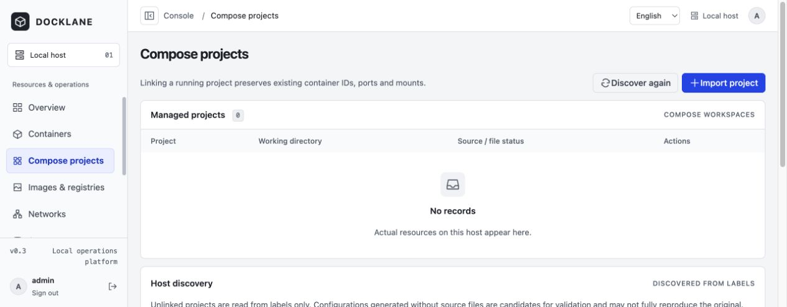
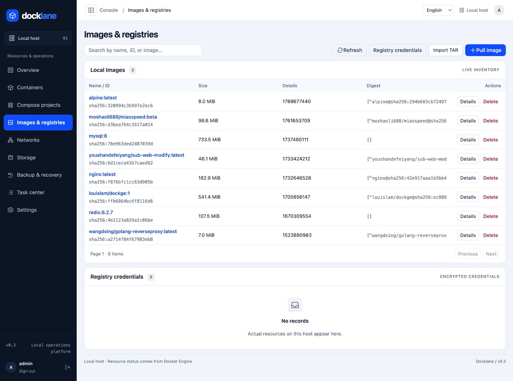
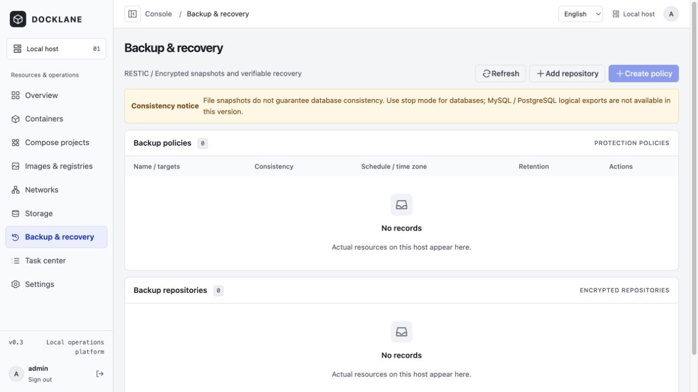
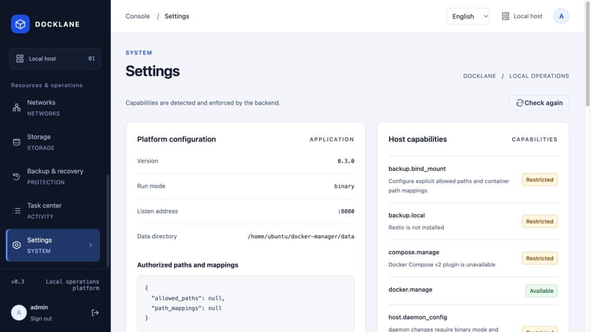

# Docklane

> This program has not undergone sufficient, rigorous testing. It is for learning and testing only; do not use it in production. Assess the risks yourself and back up important data before use.

The current source and only downloadable version is the [v0.3.1-beta.1 prerelease](https://github.com/Funnyrz/docklane/releases/tag/v0.3.1-beta.1). The old v0.3.0 Release has been withdrawn and no formal release is currently available. The stable channel is unavailable until a future formal release. Online installation without parameters defaults to the newest beta and displays the testing-only, no-production warning before making system changes. You can still explicitly select `--channel beta` or pin a version.

**Your containers. Under control.**

A single-host Docker management and local backup platform. Manage containers, Compose projects and Docker resources, follow tasks, and preview and verify local backups and restores through a bilingual web console.

The Go service embeds the Vue interface and runs as a Linux binary or Docker container. Docker Engine provides live resource state; SQLite stores management metadata only.

[简体中文](README.md) · [Features](#features) · [Screenshots](#screenshots) · [Deployment](#deployment) · [Development](#development-and-verification) · [Documentation](#documentation) · [MIT License](LICENSE)



> Promotional concept image. Refer to the text and actual screenshots for the current interface and supported features.

## Features

| Area | Available today |
| --- | --- |
| Overview | Local host connection status, resource counts, backup summary and recent tasks |
| Containers | Start, stop, restart, delete, details, logs, terminal, statistics, configuration preflight and controlled rebuilds |
| Images | Filter local lists, inspect, pull, import/export tar archives and delete individual images; encrypted registry credentials and authentication tests |
| Networks and storage | Create, inspect and delete networks and volumes; view container references and mounts; scan authorized directories for capacity |
| Compose | Discover and import existing projects, edit multiple indexed Compose configuration files, validate and deploy with checks; environment files and profiles supported |
| Local backups | Create/import local Restic repositories; file/directory, local-volume, container and Compose backups; Cron schedules with time zones and retention of the latest N snapshots |
| Restore | Snapshot preflight, new-directory restore by default, explicitly confirmed overwrite and controlled service reconstruction |
| Image acceleration | TCP/Registry connectivity diagnostics and explicit image pull tests; preview and apply mirror configuration when authorization requirements are met |
| Operations | Task progress, logs and cancellation, audit records and host diagnostics |
| Bilingual interface | Simplified Chinese `zh-CN` and English `en`, instant switching and a saved browser preference |

Docklane currently manages a single host. See [Current limitations](#current-limitations) for feature boundaries.

## Screenshots

Captured directly from the deployed Docklane test environment on 2026-10-19, these screenshots show real resources, empty states and feature availability. The Compose capture includes only the upper section, excluding raw configuration; Settings shows the first screen only. Logs, terminal output, raw configuration and audit details are excluded.



<details>
<summary>View containers, Compose, images, backups and settings</summary>

### Containers



### Compose



### Images



### Backups and restore



### Settings



</details>

## Current limitations

- Multi-host management, RBAC, remote backup repositories, Host Helper and logical database exports are not yet delivered.
- Standalone container creation, registry search, image builds/tagging/bulk cleanup, network connection management/topology and volume file browsing/editing shown in the promotional image are not implemented. Image search filters the local list; directory scans report capacity rather than providing a file manager.
- Compose editing is limited to indexed configuration files, rather than arbitrary project files or `.env` files. Compose deployments in container mode require identical host/container project paths.
- Backups do not include image archives or provide arbitrary point-in-time recovery or logical database consistency guarantees. Schedules missed while offline are recorded without automatic catch-up. Local-volume backups support only the `local` driver without extra driver options.
- Automatic mirror configuration requires explicitly authorized Linux binary mode with the necessary local Socket, tools and permissions. Docker mode provides manual instructions. Connectivity tests do not establish that a pull used a particular mirror or guarantee faster downloads.

## Supported environments

| Component | Requirements or pinned versions |
| --- | --- |
| Operating system | Linux; installation targets Ubuntu 24.04 and Debian 12/13 |
| Release architectures | `linux/amd64`, `linux/arm64` |
| Docker Engine | 28/29; deploy a version with current security fixes |
| Compose / Restic | Compose v2 (pinned validation version v2.40.3), Restic 0.19.1 |
| Build tools | Go 1.27.2, Node.js 22.22.0, pnpm 10.28.2 |

The Docker image includes Docker CLI, Compose and Restic. The online installer prepares the tools needed for binary deployments; direct execution and offline installation require preparing them separately. Cross-compiling an architecture does not establish acceptance on native hardware; see the [verification record](docs/verification.md).

## Deployment

### Product name and upgrade compatibility

**The product is Docklane, and its executable is `docklane`.** For upgrade compatibility, the systemd service and account, image tags, configuration and data directories, Go module, `DM_*` environment variables and browser storage keys retain their existing technical identifiers. Installation/upgrade scripts install the new binary as `docklane` while retaining the `docker-manager` service and existing data.

### One-command online installation (recommended)

Run on an `amd64` / `arm64` host with Ubuntu 24.04 or Debian 12/13. Root privileges and a running systemd are required:

```sh
curl -fsSL https://gh-proxy.com/https://raw.githubusercontent.com/Funnyrz/docklane/main/scripts/install-online.sh | sudo bash -s --
```

If this entrypoint is unreachable, use the backup public mirror:

```sh
curl -fsSL https://ghfast.top/https://raw.githubusercontent.com/Funnyrz/docklane/main/scripts/install-online.sh | sudo bash -s --
```

These entrypoints use public third-party services and cannot guarantee access from every region or network. A project-owned short-domain entrypoint is deferred. The installer defaults to `--download-source mirror`: GitHub API requests try `gh-proxy.com`, then the official direct endpoint; GitHub pages, Release assets, and files such as Compose / Restic try `gh-proxy.com`, `ghfast.top`, then the official direct endpoint ([public mirror documentation](https://gh-proxy.com/docs/github-accelerator)). Append `--download-source direct` to bypass all mirrors for subsequent installer downloads; use the [original script URL](https://raw.githubusercontent.com/Funnyrz/docklane/main/scripts/install-online.sh) if the entrypoint must also be fetched directly. Release, version, SHA-256 and archive checks remain unchanged. Docker's apt repository remains the official source, so access to every dependency from mainland China is not guaranteed.

Installation shows eight stages and the current download, source and retry attempt. Interactive terminals also show a real download progress bar; redirected logs use plain text.

These commands select the newest published beta, or pin a version with `--version` (currently [v0.3.1-beta.1](https://github.com/Funnyrz/docklane/releases/tag/v0.3.1-beta.1)), using release metadata and verify asset SHA-256 checksums, architecture and archive paths. The installer installs `/usr/local/bin/docklane`, creates a dedicated account and `docker-manager.service`, starts the service in the background and enables startup at boot. It checks service state, boot enablement and `/healthz`, then prints the access address. Create the administrator on your first browser visit. The default listener is `:8080`; the script does not change firewall rules.

Beta installation requires available GitHub API metadata. If the API is unreachable or rate-limited, installation stops safely and asks you to retry later; beta status is never inferred from HTML. No Release is currently available for the stable channel.

If Docker is absent, the script installs stable 29.x from the official repository and enables startup at boot. An existing usable Docker 28/29 is neither upgraded nor restarted; conflicting installations fail explicitly. Existing Compose v2 is reused; otherwise v2.40.3 is installed. Restic 0.19.1 is provided through a dedicated tools directory without overwriting versions used by other applications. The matching release's backup worker image is downloaded and loaded. The script installs base dependencies, including Python 3; downloads and package management require network access.

Choose a version and listener, or preview the actions first:

```sh
curl -fsSL https://gh-proxy.com/https://raw.githubusercontent.com/Funnyrz/docklane/main/scripts/install-online.sh \
  | sudo bash -s -- --channel beta --version v0.3.1-beta.1 --listen :8080 --dry-run
```

Remove `--dry-run` to install; use `--help` for parameters. Repeated execution preserves configuration and data, and skips replacing an identical binary with the same version and checksum. A version change stops the service and creates a backup before upgrading. Explicitly migrate an existing manually started instance rather than treating it as a fresh installation:

```sh
curl -fsSL https://gh-proxy.com/https://raw.githubusercontent.com/Funnyrz/docklane/main/scripts/install-online.sh \
  | sudo bash -s -- --channel beta --migrate-from /home/ubuntu/docklane/data
```

Add `--config /absolute/path/config.json` if the old startup configuration cannot be established reliably. Migration needs downtime and retains both the complete source data and a matching database/key backup. External business paths still need access for the dedicated account. The service retains `ProtectHome=true`; move Compose projects, repositories or backup sources under home directories to suitable authorized locations first. See [migration and recovery](docs/operations.md#手动实例迁移).

```sh
sudo systemctl status docker-manager       # Inspect service state
sudo journalctl -u docker-manager -f        # Follow logs
sudo systemctl restart docker-manager      # Restart
sudo systemctl stop docker-manager         # Stop
sudo systemctl disable docker-manager      # Disable startup at boot
```

### Beta prerelease installation and downloads

For learning and testing only. Select the published beta channel or pin this version:

```sh
curl -fsSL https://gh-proxy.com/https://raw.githubusercontent.com/Funnyrz/docklane/main/scripts/install-online.sh | sudo bash -s -- --channel beta
curl -fsSL https://gh-proxy.com/https://raw.githubusercontent.com/Funnyrz/docklane/main/scripts/install-online.sh | sudo bash -s -- --channel beta --version v0.3.1-beta.1
```

The beta Release has exactly six attachments; `RELEASE-SHA256SUMS` covers the other five:

| Attachment | Contents |
| --- | --- |
| `docklane-v0.3.1-beta.1-linux-amd64.tar.gz` | amd64 `docklane` and `LICENSE` |
| `docklane-v0.3.1-beta.1-linux-arm64.tar.gz` | arm64 `docklane` and `LICENSE` |
| `docker-manager-installation.tar.gz` | Installation scripts, configuration and documentation; root-level `VERSION`, license, internal binary/image checksums, `IMAGES.txt`, tool versions and CI evidence |
| `docker-manager-images.tar.gz` | Application and backup worker images for both architectures |
| `install-online.sh` | Version-matched online entrypoint |
| `RELEASE-SHA256SUMS` | Top-level attachment SHA-256 manifest |

Offline systemd installation requires the Docker, Compose, Restic, Python and account permissions listed below. Download the native package, installation materials, image archive and top-level manifest into an empty directory, then run these commands. On arm64, replace `amd64` with `arm64` in the package name and image tag:

```sh
sha256sum --check --ignore-missing RELEASE-SHA256SUMS
tar -xzf docklane-v0.3.1-beta.1-linux-amd64.tar.gz
tar -xzf docker-manager-installation.tar.gz
sha256sum --check IMAGE-SHA256SUMS
sudo docker load -i docker-manager-images.tar.gz
sudo docker tag docker-manager:v0.3.1-beta.1-amd64 docker-manager:v0.3.1-beta.1
sudo ./scripts/install.sh ./docklane
```

The online commands above use the current `main` entrypoint. Published v0.3.1-beta.1 assets retain their release-time snapshot; when running the attached `install-online.sh` separately, pass `--channel beta` explicitly.

The materials archive's root-level `VERSION` contains `0.3.1-beta.1` without a `v` prefix. The application version changes while configuration and database schemas remain v1. Raw binaries, `.sha256` sidecars, `IMAGES.txt` and the license are no longer separate beta attachments; these materials remain inside the installation archive. Evidence for withdrawn versions remains historical and is not a current download entrypoint.

### Native binary package: run directly

Download the native package and `RELEASE-SHA256SUMS` from the [v0.3.1-beta.1 Release](https://github.com/Funnyrz/docklane/releases/tag/v0.3.1-beta.1) into an empty directory. This example is for amd64; replace the architecture in the package name for arm64:

```sh
sha256sum --check --ignore-missing RELEASE-SHA256SUMS
tar -xzf docklane-v0.3.1-beta.1-linux-amd64.tar.gz
DM_DATA_DIR=./data DM_LISTEN=127.0.0.1:8080 ./docklane
```

The frontend is embedded. The package contains only `docklane` and `LICENSE`, without Docker CLI, Compose or Restic. Direct execution requires preparing the relevant tools and access permissions; volume backup/restore also requires loading the matching worker. On macOS, use `shasum -a 256 -c` for verification; the executable still requires Linux.

### Docker: offline installation

Download the current beta's installation materials, image archive and top-level checksum manifest into an empty directory; verify before extracting. This example is for amd64; replace the architecture in the image tag for arm64:

```sh
sha256sum --check --ignore-missing RELEASE-SHA256SUMS
tar -xzf docker-manager-installation.tar.gz
sha256sum --check IMAGE-SHA256SUMS
docker load -i docker-manager-images.tar.gz
docker tag docker-manager:v0.3.1-beta.1-amd64 docker-manager:v0.3.1-beta.1
export DM_BACKUP_HOST_DIR=/srv/docker-manager/backups
export DM_RESTORE_HOST_DIR=/srv/docker-manager/restores
mkdir -p "$DM_BACKUP_HOST_DIR" "$DM_RESTORE_HOST_DIR"
docker compose -f deployments/docker-compose.yml up -d --no-build
```

The archive includes both architectures. Set the common tag for the native architecture before starting; temporary backup/restore containers use the same version of the local worker.

### Docker: build from source

Install Git, Docker Engine, Docker Buildx (for BuildKit builds) and Compose v2, then run on a Linux host:

```sh
git clone https://github.com/Funnyrz/docklane.git
cd docklane
docker build -t docker-manager:v0.3.1-beta.1 .
export DM_BACKUP_HOST_DIR=/srv/docker-manager/backups
export DM_RESTORE_HOST_DIR=/srv/docker-manager/restores
mkdir -p "$DM_BACKUP_HOST_DIR" "$DM_RESTORE_HOST_DIR"
docker compose -f deployments/docker-compose.yml up -d --no-build
```

The example Compose file binds only to `127.0.0.1:8080`. Access it locally, through a restricted network tunnel or an HTTPS reverse proxy. The image needs no `--privileged` flag and does not mount the host root by default. Docker mode cannot write host daemon configuration or restart systemd directly.

### Linux binary and systemd

The current Release provides native `tar.gz` packages for both architectures. Installation places the executable at `/usr/local/bin/docklane`; the service is `docker-manager`. Follow [Beta prerelease installation and downloads](#beta-prerelease-installation-and-downloads) above, using the extracted `./docklane` rather than downloading a separate raw binary.

Prepare local Docker Engine 28/29, Compose v2 (validated version v2.40.3), Restic 0.19.1 on the service PATH, Python 3 and `runuser` (util-linux). The `docker` group must exist and grant the service account access to the Docker Socket through that supplementary group. Upgrade an existing managed installation with `scripts/upgrade.sh ./docklane` from matching versioned materials, retaining a consistent backup first.

The installer creates a dedicated account and systemd service. Configuration lives at `/etc/docker-manager/config.json`; application data lives at `/var/lib/docker-manager`. Docker group access still grants high privileges. Grant backup-source read access and repository/restore-directory write access separately. Daemon writes and service restarts are not granted by default.

### First visit and language

Open your deployment address and create the administrator with a password of at least 12 bytes. Initialization can succeed only once. Login and diagnostics remain available while Docker is unavailable. Keep the management port behind access controls rather than exposing it directly to the public internet.

Switch languages on the initialization page, login page or console header. The first visit matches the browser's Chinese/English preference and falls back to Simplified Chinese. Manual choices use `localStorage` key `docker-manager:locale`. Switching preserves the page, connections and unsaved forms. Logs, terminal output, resource names and raw diagnostics retain their original content.

## Configuration and data protection

- Load JSON configuration with `DM_CONFIG`; environment variables override supported options. See the [example configuration](deployments/config.example.json) and [operations guide](docs/operations.md).
- `DM_ALLOWED_PATHS` authorizes explicit absolute paths. Container mode also needs host/container mappings in `DM_PATH_MAPPINGS`. The filesystem root `/` cannot be authorized.
- Settings → Configure features can save allowed directories, path mappings and host-operation authorization on supported deployments. Confirm with the current administrator password and restart Docklane to activate changes. Saved values override the corresponding configuration-file and environment fields; see the [operations guide](docs/operations.md).
- Use a dedicated, writable application data directory for one instance only. Back up its database together with the matching `master.key`. Preserve the Restic repository and password separately offline; recovery exports contain secrets.
- Docker Socket access grants high host privileges. Temporary backup containers mount only selected sources and the repository, without the Socket. Mount directory backup sources separately as read-only, and give repository and restore directories their own write permissions.
- Keep the running image and `DM_BACKUP_WORKER_IMAGE` (`backup_worker_image` in binary configuration) on the same version. Verify a backup and a restore to a new directory after deployment.
- File verification does not establish logical database consistency. Stop-mode backups must cover every known writer. Configuration rollback cannot undo data already written by an application.
- Restore defaults to a new directory. Overwriting the original location requires separate confirmation. A failed or interrupted overwrite may leave writers stopped; verify the data before explicitly starting them.
- Before upgrading, stop the service and retain complete application data, configuration and the previous binary or image. Roll back with a matching database and key; do not open an upgraded database directly with an older application.

## Development and verification

Install the build tools listed above, Git and Make. These steps build and run from source on a Linux host. Docker, Compose and backup features also require their respective runtime tools and access permissions:

```sh
git clone https://github.com/Funnyrz/docklane.git
cd docklane
make setup
make build
DM_DATA_DIR=./data DM_LISTEN=127.0.0.1:8080 ./bin/docklane
```

For frontend development, run `pnpm --dir web dev`. Vite proxies `/api` to local port `:8080`. The interface uses real APIs and provides no simulated business data.

```sh
make check          # Formatting, static checks, Go/frontend tests and race checks
make integration    # Run only on an isolated Linux Docker test host
make release        # Both Linux binary architectures, slim tar.gz packages and checksums
make release-images # Both image architectures and offline archive; requires Docker Buildx
```

Raw source-build binaries and internal checksums default to `bin/release-internal/`, overridden by `RELEASE_BUILD_DIR`; the final six attachments go to `bin/release/`, overridden by `RELEASE_OUTPUT_DIR`. To install from source, use `sudo ./scripts/install.sh ./bin/release-internal/docklane-linux-amd64`. For a beta Release, install the `./docklane` extracted from the native package.

Translations live in `web/src/i18n/`. Add both languages with matching interpolation parameters for new text. `pnpm --dir web test` covers dictionary consistency and language switching.

## Documentation

Detailed guides are currently primarily in Chinese; the resource API and internal implementation contract are in English.

- [Installation, permissions, upgrades and disaster recovery](docs/operations.md)
- [Public API](docs/api.md) · [Resource API](docs/resources-api.md) · [Workflow API](docs/workflows-api.md)
- [Security verification and known limitations](docs/security-notes.md)
- [Release acceptance reproduction](docs/release-acceptance.md) · [Acceptance matrix](docs/acceptance-matrix.md)
- [Verification report](docs/verification.md) · [Development plan](docs/development-plan-v0.3.md)

These records define the scope of testing and static checks. They do not establish a complete penetration test, permission validation across every distribution or acceptance under every failure condition.

## License

Docklane is licensed under the [MIT License](LICENSE), with `Copyright (c) 2026 Funnyrz`. Retain the copyright and permission notices when distributing copies.

Slim binary packages, installation materials and release candidate directories include `LICENSE`. Docker images include it at `/usr/share/licenses/docklane/LICENSE`. Third-party dependencies and tools distributed with the image remain subject to their respective licenses.
