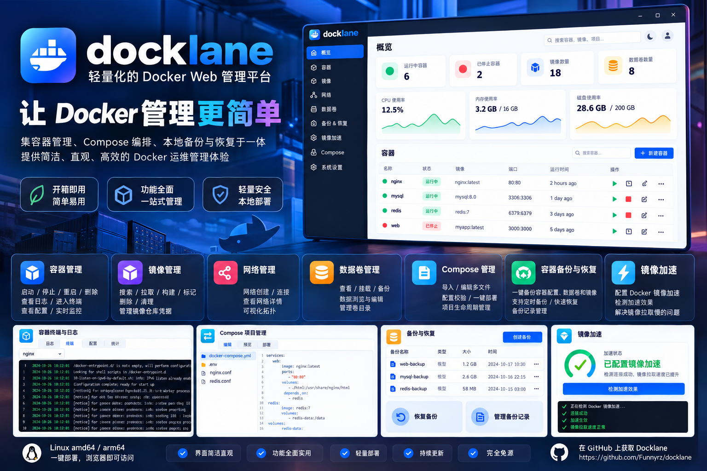
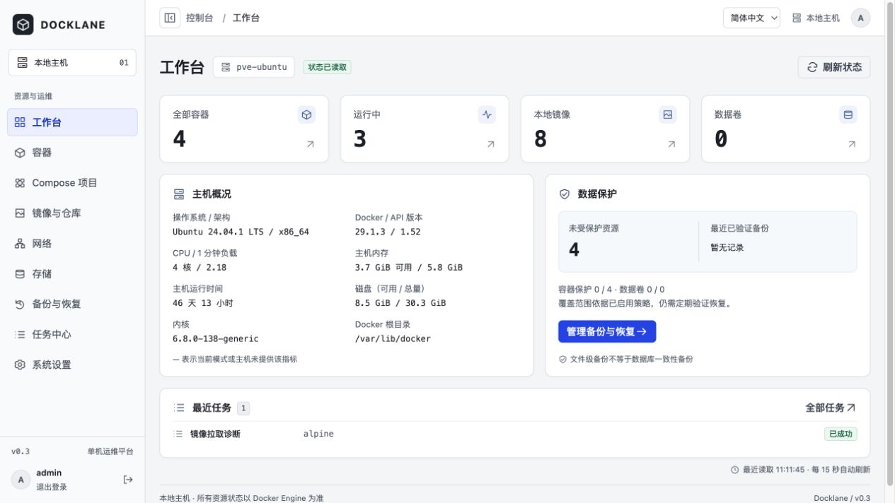
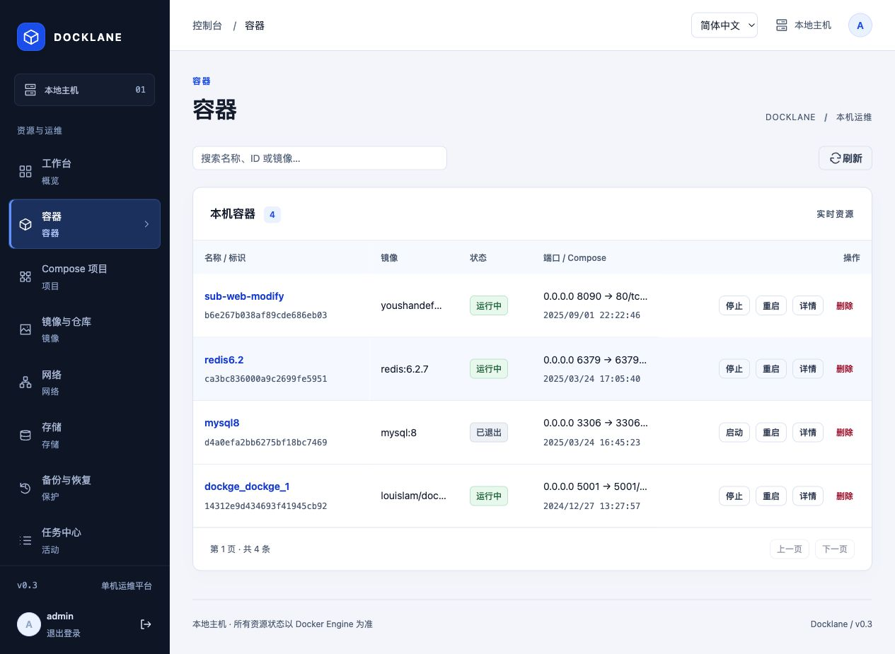
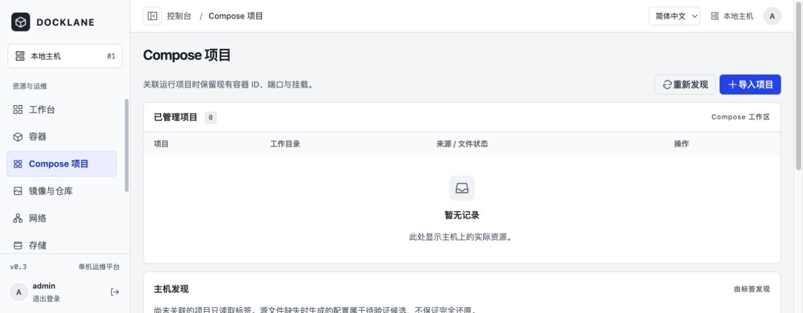
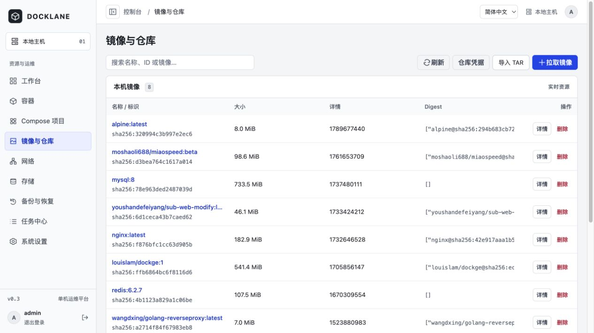
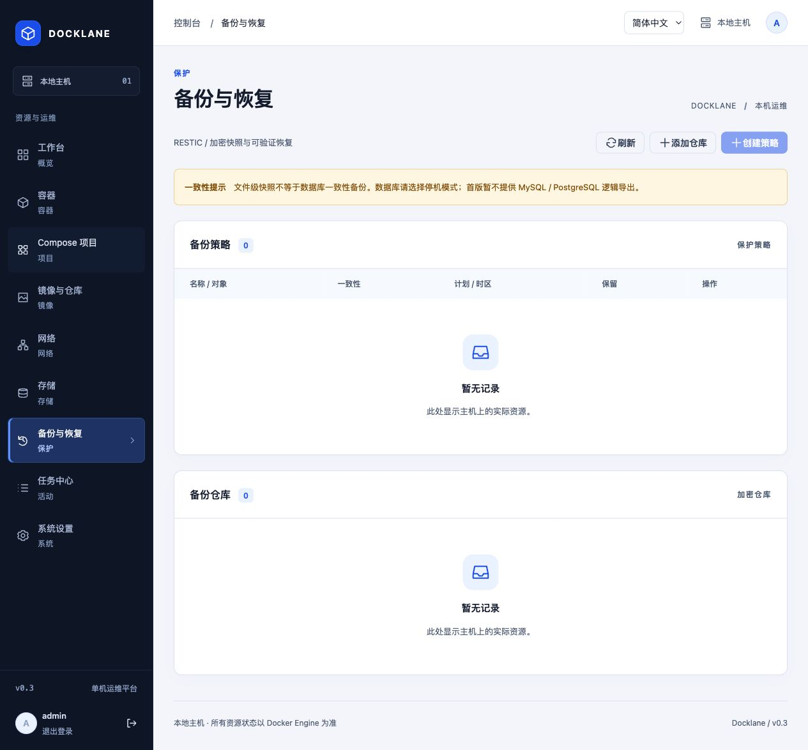
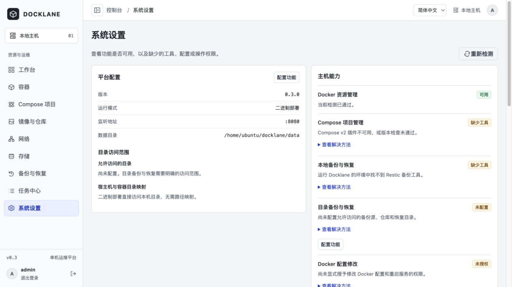

# Docklane

**Your containers. Under control.**

单机 Docker 管理与本地备份恢复平台。通过一个中英文 Web 控制台管理容器、Compose 项目和 Docker 资源，查看任务进度，并完成可预检、可验证的本地备份与恢复。

Go 服务嵌入 Vue 界面，支持 Linux 二进制和 Docker 部署。Docker Engine 是资源实时状态来源，SQLite 仅保存管理元数据。

[English](README.en.md) · [功能](#功能概览) · [截图](#界面预览) · [部署](#部署) · [开发](#开发与验证) · [文档](#详细文档) · [MIT 协议](LICENSE)



> 项目宣传概念图，实际界面与功能以正文和真实截图为准。

## 功能概览

| 能力 | 当前提供 |
| --- | --- |
| 工作台 | 本地主机连接状态、资源统计、备份概况和最近任务 |
| 容器管理 | 启动、停止、重启、删除、详情、日志、终端、统计、配置预检与受控重建 |
| 镜像管理 | 本地列表筛选、详情、拉取、tar 导入/导出、单项删除，镜像仓库凭据加密保存与认证测试 |
| 网络与存储 | 网络和卷的创建、查看、删除，容器引用与挂载关系查看，授权目录容量扫描 |
| Compose | 发现与导入已有项目，编辑已索引的多个 Compose 配置文件，校验与受控部署；支持环境文件与 profiles |
| 本地备份 | 本地 Restic 仓库创建/导入，文件或目录、本地卷、容器及 Compose 备份，Cron/时区计划与最近 N 份保留策略 |
| 恢复 | 快照预检、默认恢复到新目录、显式确认的原位置覆盖与受控服务重建 |
| 镜像加速 | TCP/Registry 连通性诊断、显式镜像拉取测试；满足授权条件时预览和应用镜像源配置 |
| 运维记录 | 任务进度、日志与取消，审计记录及主机诊断 |
| 中英文界面 | 简体中文 `zh-CN` 与英语 `en`，即时切换并记住浏览器选择 |

当前面向单机管理，具体功能边界见下方[当前限制](#当前限制)。

## 界面预览

以下截图于 2026-10-19 直接采集自已部署的 Docklane 测试环境，展示真实资源、空状态及功能可用性。Compose 仅截取不含原始配置的页面上半区；设置页仅展示首屏，未收录日志、终端、原始配置和审计详情。



<details>
<summary>查看容器、Compose、镜像、备份与设置</summary>

### 容器



### Compose



### 镜像



### 备份与恢复



### 系统设置



</details>

## 当前限制

- 多机管理、RBAC、远程备份仓库、Host Helper 和数据库逻辑导出尚未交付。
- 宣传图中的独立新建容器、镜像仓库搜索/构建/打标/批量清理、网络连接管理与拓扑、卷文件浏览与编辑尚未实现。镜像搜索框仅筛选本地列表；目录扫描统计容量，不提供文件管理器。
- Compose 在线编辑仅面向已索引的配置文件，不支持任意项目文件或 `.env` 文件编辑；容器模式下部署 Compose 需要宿主机与容器内项目路径一致。
- 备份不包含镜像归档，不提供任意时间点恢复或数据库逻辑一致性保证；离线期间错过的计划仅记为漏执行，不自动补跑。本地卷备份限不带额外驱动选项的 `local` 卷。
- 镜像源自动配置仅适用于显式授权且满足本地 Socket、工具和权限要求的 Linux 二进制模式；Docker 模式提供手工配置指南。连通性测试不代表拉取必经某镜像源，也不保证速度提升。

## 支持环境

| 项目 | 要求或已锁定版本 |
| --- | --- |
| 运行系统 | Linux；安装目标为 Ubuntu 24.04、Debian 12/13 |
| 发布架构 | `linux/amd64`、`linux/arm64` |
| Docker Engine | 28/29；部署时应使用含安全修复的版本 |
| Compose / Restic | Compose v2（锁定验证版本 v2.40.3）、Restic 0.19.1 |
| 构建工具 | Go 1.27.2、Node.js 22.22.0、pnpm 10.28.2 |

Docker 镜像包含 Docker CLI、Compose 和 Restic；在线安装脚本自动准备二进制部署需要的运行工具，直接运行或离线安装时需自行准备。交叉构建出某架构产物不代表已完成该架构原生硬件验收，具体见[验证记录](docs/verification.md)。

## 部署

### 名称与升级兼容

**产品与可执行文件均命名为 Docklane（命令为 `docklane`）。** 为保持升级兼容，systemd 服务和账号、镜像标签、配置与数据目录、Go module、`DM_*` 环境变量及浏览器存储键仍保留现有技术标识。安装/升级脚本会将新二进制安装为 `docklane`，并继续使用 `docker-manager` 服务管理已有数据。

### 一键在线安装（推荐）

在 Ubuntu 24.04 或 Debian 12/13 的 `amd64` / `arm64` 主机运行，要求 root 权限和正在运行的 systemd：

```sh
curl -fsSL https://raw.githubusercontent.com/Funnyrz/docklane/main/scripts/install-online.sh | sudo bash -s --
```

脚本解析一次最新正式 [GitHub Release](https://github.com/Funnyrz/docklane/releases/latest)，固定版本并校验下载资产的 SHA-256、架构和归档路径，安装 `/usr/local/bin/docklane`，创建专用账号及 `docker-manager.service`，自动后台启动并设置开机自启。结束时检查服务状态、自启和 `/healthz`，输出访问地址；首次打开页面创建管理员。默认监听 `:8080`，不自动修改防火墙。

匿名 GitHub API 限流时，脚本可通过公开的最新正式 Release 链接完成 latest 或同版本安装；明确指定旧版本仍需 API 元数据，限流时会安全停止并提示稍后重试。

缺少 Docker 时从官方软件源安装稳定 29.x 并启用自启；已有可用 Docker 28/29 不会被升级或重启，冲突安装会报错。复用已有 Compose v2，缺失时安装 v2.40.3；提供 Restic 0.19.1，使用专属工具目录而不覆盖其他应用使用的版本。同一 Release 的备份 worker 镜像会下载并加载。基础依赖（包括 Python 3）由脚本补齐，下载与包管理需要联网。

指定版本、监听地址，或先查看执行计划：

```sh
curl -fsSL https://raw.githubusercontent.com/Funnyrz/docklane/main/scripts/install-online.sh \
  | sudo bash -s -- --version v0.3.0 --listen :8080 --dry-run
```

去掉 `--dry-run` 执行安装；`--help` 查看参数。再次执行会保留现有配置与数据，同版本且校验和相同则跳过二进制替换；版本变化先停机备份再升级。已有手动运行实例必须显式迁移，不能直接当作全新安装：

```sh
curl -fsSL https://raw.githubusercontent.com/Funnyrz/docklane/main/scripts/install-online.sh \
  | sudo bash -s -- --migrate-from /home/ubuntu/docklane/data
```

脚本无法可靠取得旧启动配置时，增加 `--config /绝对路径/config.json`。迁移需要短暂停机，保留完整源数据和数据库/密钥配套备份；外部业务路径仍需专用账号可访问。服务保留 `ProtectHome=true`，位于 home 下的 Compose、仓库或备份源需先迁移到适当的授权目录。详见[迁移与恢复说明](docs/operations.md#手动实例迁移)。

```sh
sudo systemctl status docker-manager       # 查看服务状态
sudo journalctl -u docker-manager -f        # 查看日志
sudo systemctl restart docker-manager      # 重启
sudo systemctl stop docker-manager         # 停止
sudo systemctl disable docker-manager      # 取消开机自启
```

### 选择下载包

从 [v0.3.0 Release](https://github.com/Funnyrz/docklane/releases/tag/v0.3.0) 下载匹配架构的资产。在线安装会自动取得同一版本所需材料；手工安装先校验相应校验清单。

| 下载文件 | 适用场景 |
| --- | --- |
| `docklane-v0.3.0-linux-amd64.tar.gz` | x86-64 Linux 精简二进制包 |
| `docklane-v0.3.0-linux-arm64.tar.gz` | ARM64 Linux 精简二进制包 |
| `docker-manager-installation.tar.gz` | systemd 安装、升级、卸载与在线安装辅助材料，配置示例、文档和 MIT 协议 |
| `docker-manager-images.tar.gz` | 双架构离线 Docker / 备份 worker 镜像 |

每个精简包配有同名 `.tar.gz.sha256` 校验文件，包含可执行文件 `docklane` 和 `LICENSE`。程序已嵌入前端，无需单独安装前端。Release 同时提供原始双架构二进制、`LICENSE` 及 `RELEASE-SHA256SUMS`。维护者另行生成的 `docklane-v0.3.0-<时间戳>.tar.gz` 完整包将这些材料放在 `docklane-v0.3.0/` 目录内。

### 精简二进制包：直接运行

在空目录下载对应架构的包及校验文件。以下为 amd64 示例；arm64 主机将文件名中的 `amd64` 改为 `arm64`：

```sh
sha256sum -c docklane-v0.3.0-linux-amd64.tar.gz.sha256
tar -xzf docklane-v0.3.0-linux-amd64.tar.gz
DM_DATA_DIR=./data DM_LISTEN=127.0.0.1:8080 ./docklane
```

macOS 上校验可使用 `shasum -a 256 -c`；程序仍需在 Linux 运行。访问 `http://127.0.0.1:8080` 初始化管理员。

精简包不包含 Docker CLI、Compose 或 Restic。管理容器前需安装 Docker Engine 并授权当前账号访问；Compose 功能另需 Compose v2，本地备份/恢复另需 Restic 0.19.1。Volume 备份/恢复还需可用的同版本 worker 镜像，详见下方配置说明。

### Docker：离线安装

在空目录下载并校验 Release 的安装材料、镜像归档和清单（或解压完整发布包并进入 `docklane-v0.3.0/`）后执行。以下为 amd64 示例；arm64 主机将镜像标签中的 `amd64` 改为 `arm64`。

```sh
sha256sum --check --ignore-missing RELEASE-SHA256SUMS
tar -xzf docker-manager-installation.tar.gz
docker load -i docker-manager-images.tar.gz
docker tag docker-manager:v0.3.0-amd64 docker-manager:v0.3.0
export DM_BACKUP_HOST_DIR=/srv/docker-manager/backups
export DM_RESTORE_HOST_DIR=/srv/docker-manager/restores
mkdir -p "$DM_BACKUP_HOST_DIR" "$DM_RESTORE_HOST_DIR"
docker compose -f deployments/docker-compose.yml up -d --no-build
```

发布归档同时提供两种架构镜像；启动前只需为本机架构设置通用标签。临时备份/恢复容器使用相同的本地镜像，默认不会自动拉取 worker 镜像。

### Docker：从源码构建

准备 Git、Docker Engine、Docker Buildx（使用 BuildKit 构建）和 Compose v2，在 Linux 主机执行：

```sh
git clone https://github.com/Funnyrz/docklane.git
cd docklane
docker build -t docker-manager:v0.3.0 .
export DM_BACKUP_HOST_DIR=/srv/docker-manager/backups
export DM_RESTORE_HOST_DIR=/srv/docker-manager/restores
mkdir -p "$DM_BACKUP_HOST_DIR" "$DM_RESTORE_HOST_DIR"
docker compose -f deployments/docker-compose.yml up -d --no-build
```

示例 Compose 仅绑定 `127.0.0.1:8080`，通过本机浏览器、受限网络隧道或 HTTPS 反向代理访问。镜像无需 `--privileged`，也不默认挂载宿主机根目录。Docker 模式不允许直接写入宿主机 daemon 配置或重启 systemd。

### Linux 二进制与 systemd

Release 提供 `docklane-linux-amd64` 与 `docklane-linux-arm64`；安装后可执行文件为 `/usr/local/bin/docklane`，服务名仍为 `docker-manager`。已有安装使用新包的 `scripts/upgrade.sh`，由脚本处理旧可执行文件路径到 `docklane` 的切换，配置与数据目录保持原位置。

准备可用的本地 Docker Engine 28/29、Compose v2（验证版本 v2.40.3）、服务 PATH 可用的 Restic 0.19.1、Python 3 与 `runuser`（util-linux）。`docker` 组必须存在，Docker Socket 须允许服务账号通过该附加组访问。将同一 Release 的对应原始二进制、`docker-manager-installation.tar.gz`、`docker-manager-images.tar.gz`、`IMAGE-SHA256SUMS`、`IMAGES.txt` 和 `RELEASE-SHA256SUMS` 下载到同一空目录（或进入完整包解压目录）。下面同时准备安装所需的本地 worker；arm64 主机将二进制与镜像标签中的 `amd64` 改为 `arm64`：

```sh
sha256sum --check --ignore-missing RELEASE-SHA256SUMS
sha256sum --check IMAGE-SHA256SUMS
tar -xzf docker-manager-installation.tar.gz
sudo docker load -i docker-manager-images.tar.gz
sudo docker tag docker-manager:v0.3.0-amd64 docker-manager:v0.3.0
sudo ./scripts/install.sh ./docklane-linux-amd64
sudo journalctl -u docker-manager -f
```

安装脚本创建专用账号及 systemd 服务，配置位于 `/etc/docker-manager/config.json`，应用数据位于 `/var/lib/docker-manager`。服务账号的 Docker 组访问仍属于高权限；备份源读取及仓库/恢复目录写入权限需另外配置。默认不授予 daemon 写入或服务重启权限。

### 首次访问与语言

打开部署地址创建管理员，密码至少 12 字节；初始化只允许成功一次。Docker 暂时不可用时仍可登录查看诊断。不要将未经访问控制的管理端口暴露到公网。

初始化页、登录页及控制台顶部均可切换语言。首次访问按浏览器语言匹配中英文，无法匹配时默认简体中文；手动选择保存在 `localStorage` 的 `docker-manager:locale`。切换保留页面、连接和未提交表单，日志、终端、资源名称与原始诊断内容保留原文。

## 配置与数据保护

- 通过 `DM_CONFIG` 加载 JSON 配置，环境变量覆盖支持的选项；参见[示例配置](deployments/config.example.json)与[运维说明](docs/operations.md)。
- `DM_ALLOWED_PATHS` 授权显式绝对路径；容器模式还需通过 `DM_PATH_MAPPINGS` 声明宿主机与容器路径映射。根目录 `/` 不可作为授权路径。
- “系统设置 → 配置功能”可直接保存允许目录、路径映射及支持环境下的宿主机操作授权。使用当前管理员密码确认，重启 Docklane 生效；页面保存值优先于对应配置文件和环境变量，详见[运维说明](docs/operations.md)。
- 应用数据目录必须独立、可写且仅供一个实例使用；完整备份数据库和匹配的 `master.key`。Restic 仓库与口令需另行离线保管，恢复材料包含秘密。
- Docker Socket 相当于宿主机高权限。临时备份容器只挂载明确选择的数据源和仓库，不挂载 Socket；目录备份源应单独只读映射，仓库和恢复目录分别授予写权限。
- 运行镜像与 `DM_BACKUP_WORKER_IMAGE`（二进制配置为 `backup_worker_image`）应保持同版本。部署后先验证一次备份与新目录恢复。
- 文件校验不等于数据库逻辑一致性；停机备份必须覆盖所有已知写入者。配置回退不能撤销应用已写入的数据。
- 恢复默认写入新目录；原位置覆盖需单独确认，失败或中断时可能保留写入者停机，必须验证数据后再显式启动。
- 升级前停止服务并保留完整应用数据、配置、旧二进制或镜像。回退时恢复相互匹配的数据库与密钥，不用旧程序直接打开已升级数据库。

## 开发与验证

安装上表中的构建工具、Git 和 Make。以下步骤在 Linux 主机从源码构建并运行；运行 Docker、Compose 或备份功能时，还需相应运行工具及访问权限：

```sh
git clone https://github.com/Funnyrz/docklane.git
cd docklane
make setup
make build
DM_DATA_DIR=./data DM_LISTEN=127.0.0.1:8080 ./bin/docklane
```

前端独立开发运行 `pnpm --dir web dev`，Vite 将 `/api` 代理到本地 `:8080`；页面使用真实 API，不提供模拟业务数据。

```sh
make check          # 格式、静态检查、Go/前端测试及 race 检查
make integration    # 仅在隔离 Linux Docker 测试主机执行
make release        # Linux 双架构二进制、精简 tar.gz 包与校验文件
make release-images # 双架构镜像及离线归档，需要 Docker Buildx
```

源码发布命令的产物默认位于 `bin/release/`，可通过 `RELEASE_OUTPUT_DIR` 指定发布脚本输出目录；从源码安装时使用 `sudo ./scripts/install.sh ./bin/release/docklane-linux-amd64`。

中英文词典位于 `web/src/i18n/`；新增文案需同时补齐两种语言及相同插值参数。`pnpm --dir web test` 覆盖词条一致性和切换行为。

## 详细文档

- [安装、权限、升级与灾难恢复](docs/operations.md)
- [公共 API](docs/api.md) · [资源 API](docs/resources-api.md) · [工作流 API](docs/workflows-api.md)
- [安全验证与已知限制](docs/security-notes.md)
- [发布验收复现](docs/release-acceptance.md) · [验收矩阵](docs/acceptance-matrix.md)
- [验证报告](docs/verification.md) · [开发计划](docs/development-plan-v0.3.md)

测试与静态检查的覆盖范围以这些记录为准，不代表完整渗透测试、所有发行版权限验证或全部故障条件验收。

## 开源协议

Docklane 使用 [MIT 协议](LICENSE)，版权署名为 `Copyright (c) 2026 Funnyrz`。分发副本时请保留协议中的版权和许可声明。

精简二进制包、安装材料及候选发布目录携带 `LICENSE`；Docker 镜像内路径为 `/usr/share/licenses/docklane/LICENSE`。第三方依赖与随镜像分发的工具仍适用各自的许可。
